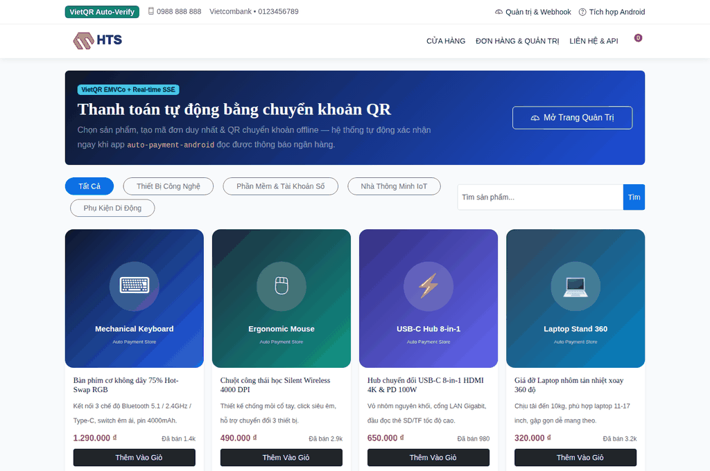
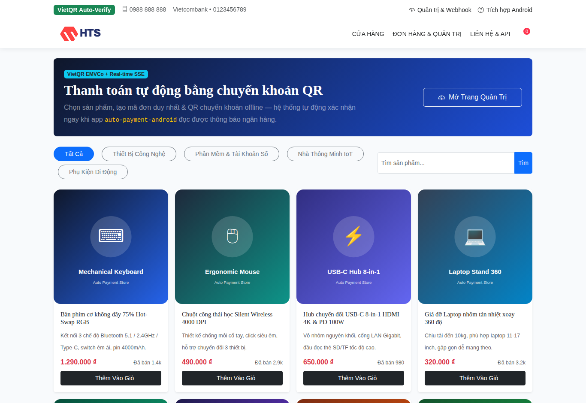
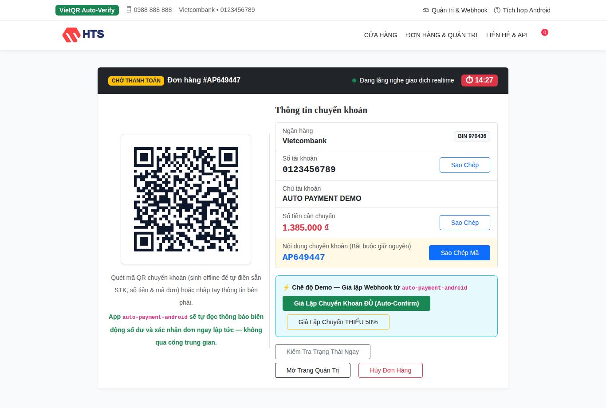
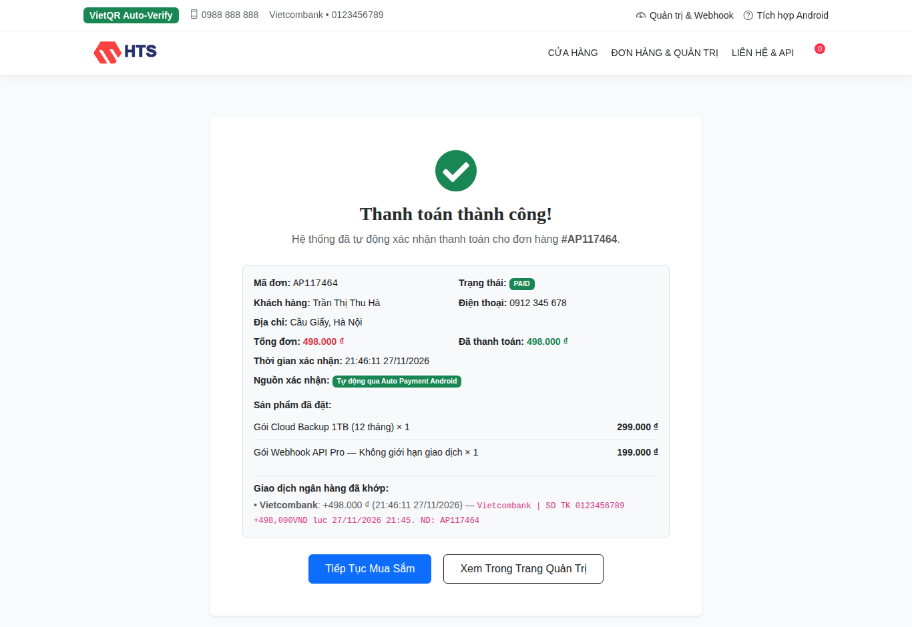
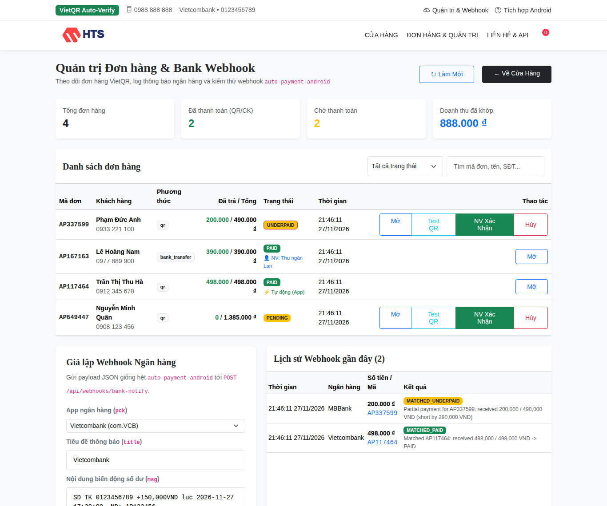
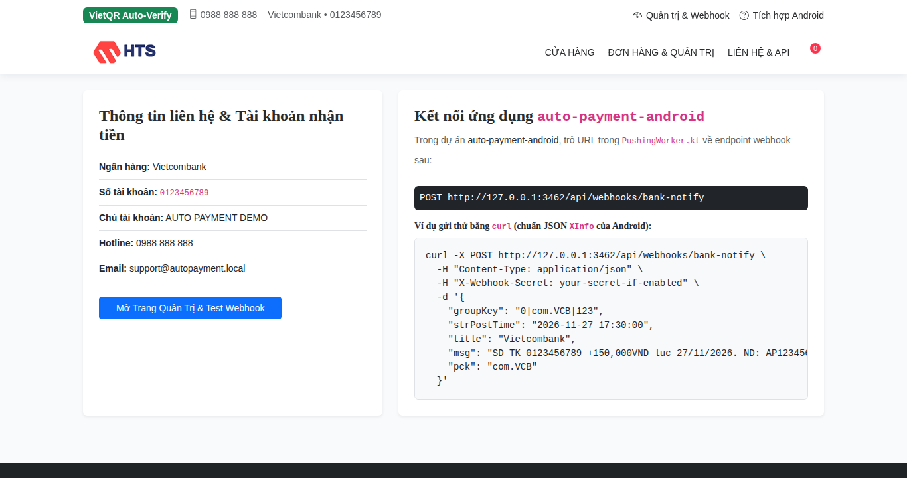

# Auto Payment

[](https://github.com/sinhsac/auto-payment/actions/workflows/ci.yml)
[](LICENSE)
[](https://nuxt.com/)
[](https://vuejs.org/)
[](https://nodejs.org/)

A self-hosted, zero-fee automated bank transfer payment system built with **Nuxt 4**, **Vue 3**, and **Nitro Server Routes** — designed as the web/server half of a unified system together with **[auto-payment-android](https://github.com/sinhsac/auto-payment-android)**.

### How the Unified System Works (No Payment Gateway Fees)

1. **Web (`auto-payment`)** creates an order with a unique reference code (e.g., `AP123456`) and displays transfer instructions (plus a local offline QR code purely so buyers don't mistype the account number, amount, or order code).
2. **Android App (`auto-payment-android`)** runs on the merchant's Android phone, listens to incoming bank/wallet notifications (`android.bigText` / `android.text`), filters for the web-generated order code (`APxxxxxx`) + incoming credit amount, and posts it to `POST /api/webhooks/bank-notify`.
3. **Web Server (`auto-payment`)** verifies the order code & amount, marks the order `PAID` (or `UNDERPAID` on partial payment), and pushes an instant **Server-Sent Events (SSE)** update so the buyer's browser automatically transitions to **Order Completed**.

> **Legacy Archive**: The original Nuxt 3.11 / Vue 3.4 snapshot is archived under release [`v0.1.0-legacy`](https://github.com/sinhsac/auto-payment/releases/tag/v0.1.0-legacy).

## Live Demo & Screenshots

<p align="center">
  
</p>

| Storefront & Product Catalog | Real-Time Payment QR & SSE Listener |
| :---: | :---: |
|  |  |
| **Auto-Confirmed Order Receipt** | **Admin Dashboard, Staff Fallback & Webhook Tester** |
|  |  |

<details>
<summary>View Android Webhook Integration Guide screenshot</summary>



</details>

## Key Features

- **Real EMVCo / VietQR Generator (`server/utils/vietqr.ts`)**: Generates standards-compliant NAPAS 247 dynamic QR codes (with exact VND amount, bank BIN, account number, order reference code, and CRC-16/CCITT-FALSE checksum) locally using `qrcode` — scannable by all major Vietnamese banking apps.
- **Automated Bank Notification Webhook (`POST /api/webhooks/bank-notify`)**:
  - 100% compatible with **`auto-payment-android`**'s `XInfo` JSON payload (`groupKey`, `postTime`, `strPostTime`, `title`, `msg`, `pck`) as well as generic `{ amount, content, transactionId, bank }` webhooks.
  - Parses incoming credit alerts from **Vietcombank, Techcombank, MBBank, VPBank, BIDV, ACB, TPBank, VietinBank, Sacombank, Timo, MoMo, and ZaloPay**.
  - Rejects outgoing debits (`-150,000VND`, debit keywords), deduplicates repeated notifications idempotently, and cleanly tracks partial payments (`UNDERPAID`) until the full balance is received (`PAID`).
  - Optional constant-time secret verification via `X-Webhook-Secret` or `Authorization: Bearer <secret>`.
- **Real-Time Order Confirmation (SSE)**: `GET /api/orders/:code/stream` pushes live status transitions immediately to the customer's checkout screen (with countdown timer and automatic polling fallback).
- **Zero-Config Storefront & Optional Elasticsearch**: Ships with a built-in demo product catalog (12 products across 4 categories) so `npm run dev` works immediately; automatically switches to Elasticsearch when `NUXT_ELASTICSEARCH_BASE_URL` and `NUXT_ELASTICSEARCH_TOKEN` are configured.
- **Persistent Orders & Admin Dashboard (`/admin`)**:
  - Atomic JSON persistence (`data/store.json`) with zero database setup.
  - Live revenue KPIs, filterable order table, manual approve/cancel actions, webhook audit log, and an **interactive `auto-payment-android` webhook simulator**.
- **Shareable Order Tracking URLs (`/orders/:code`)**: Customers can bookmark or refresh `/orders/AP123456` without losing their QR code or receipt.

## API Endpoints

| Method | Endpoint | Description |
| :--- | :--- | :--- |
| `GET` | `/api/categories` | Lists product categories (Elasticsearch or built-in demo catalog). |
| `GET` | `/api/categories/:id` | Returns a single category by `catid`. |
| `GET` | `/api/products` | Lists/filters products by `category`, `q` (search), and `lastId` (ES pagination). |
| `POST` | `/api/orders` | Creates a new order (`qr`, `bank_transfer`, or `cod`) and generates a dynamic VietQR code. |
| `GET` | `/api/orders` | Lists orders (`?status=`, `?q=`) and summary KPI stats for `/admin`. |
| `GET` | `/api/orders/:code` | Retrieves live order details (auto-expires unpaid QR orders past deadline). |
| `GET` | `/api/orders/:code/stream` | Server-Sent Events (SSE) real-time stream for order payment updates. |
| `POST` | `/api/orders/:code/action` | Staff manual confirmation fallback (`{ "action": "confirm_by_staff", "staffName": "...", "note": "..." }`) or cancel (`{ "action": "cancel" }`). |
| `GET` | `/api/health` | Health-check endpoint for server monitoring and Android connectivity checks. |
| `POST` | `/api/webhooks/bank-notify` | Receives bank credit notifications (`auto-payment-android` `XInfo` or generic JSON) and auto-matches orders. |
| `GET` | `/api/webhooks/logs` | Returns recent bank webhook audit logs and matching outcomes. |

## Quick Start

### 1. Install & Run Locally (Zero External Services Needed)

```bash
git clone https://github.com/sinhsac/auto-payment.git
cd auto-payment
npm install
npm run dev
```

Open **`http://localhost:3000`**:
1. Add any product to the cart and click **Thanh toán**.
2. Fill in customer details, choose **VietQR**, and place the order.
3. On `/orders/APxxxxxx`, scan the generated VietQR code or click **"Giả lập chuyển khoản ĐỦ (Auto-Confirm)"** — the page immediately transitions to **Order Completed** via SSE.
4. Visit **`http://localhost:3000/admin`** to inspect orders, revenue stats, and webhook logs, or test custom Vietnamese bank notification messages.

### 2. Configure Your Bank Account & Webhook Secret

Copy `local.env` to `.env` and update your bank details:

```env
NUXT_BANK_BIN=970436
NUXT_BANK_NAME=Vietcombank
NUXT_BANK_ACCOUNT_NO=0123456789
NUXT_BANK_ACCOUNT_NAME=YOUR ACCOUNT NAME
NUXT_ORDER_PREFIX=AP
NUXT_ORDER_EXPIRY_MINUTES=15

NUXT_PUBLIC_BANK_NAME=Vietcombank
NUXT_PUBLIC_BANK_ACCOUNT_NO=0123456789
NUXT_PUBLIC_BANK_ACCOUNT_NAME=YOUR ACCOUNT NAME

# Recommended in production:
NUXT_WEBHOOK_SECRET=replace-with-a-strong-random-secret
NUXT_PUBLIC_ENABLE_DEMO_SIMULATOR=false
```

### 3. Connect `auto-payment-android`

Point `PushingWorker.kt` in [auto-payment-android](https://github.com/sinhsac/auto-payment-android) to:

```text
POST https://your-domain.com/api/webhooks/bank-notify
```

Example webhook test with `curl`:

```bash
curl -X POST http://localhost:3000/api/webhooks/bank-notify \
  -H "Content-Type: application/json" \
  -H "X-Webhook-Secret: your-secret" \
  -d '{
    "groupKey": "0|com.VCB|123",
    "strPostTime": "2026-11-27 17:30:00",
    "title": "Vietcombank",
    "msg": "SD TK 0123456789 +150,000VND luc 27/11/2026. ND: AP123456",
    "pck": "com.VCB"
  }'
```

## Testing & Production Deployment

```bash
# Run automated unit & integration tests (VietQR CRC16, bank parser, OrderStore)
npm test

# Build production bundle
npm run build

# Start production server directly
node .output/server/index.mjs

# Or run with PM2 (port 3030)
pm2 start ecosystem.config.cjs
```

## License

This project is licensed under the **MIT License** — see the [LICENSE](LICENSE) file for details.
